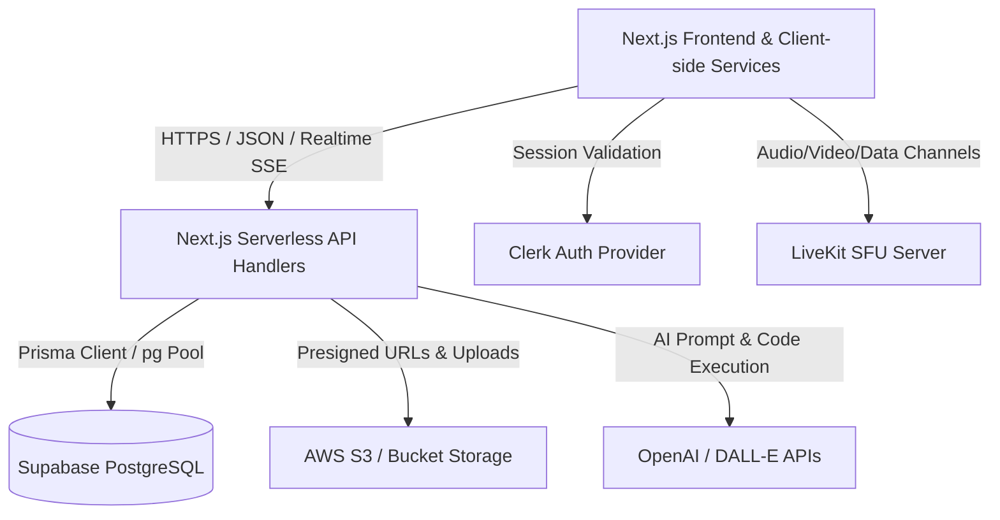
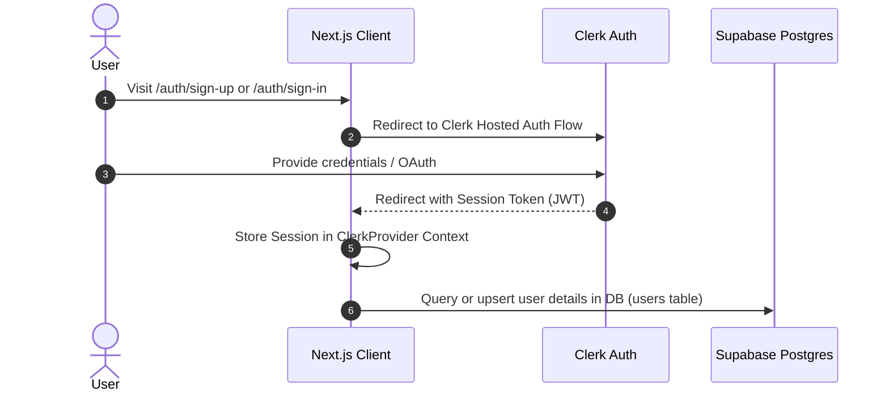
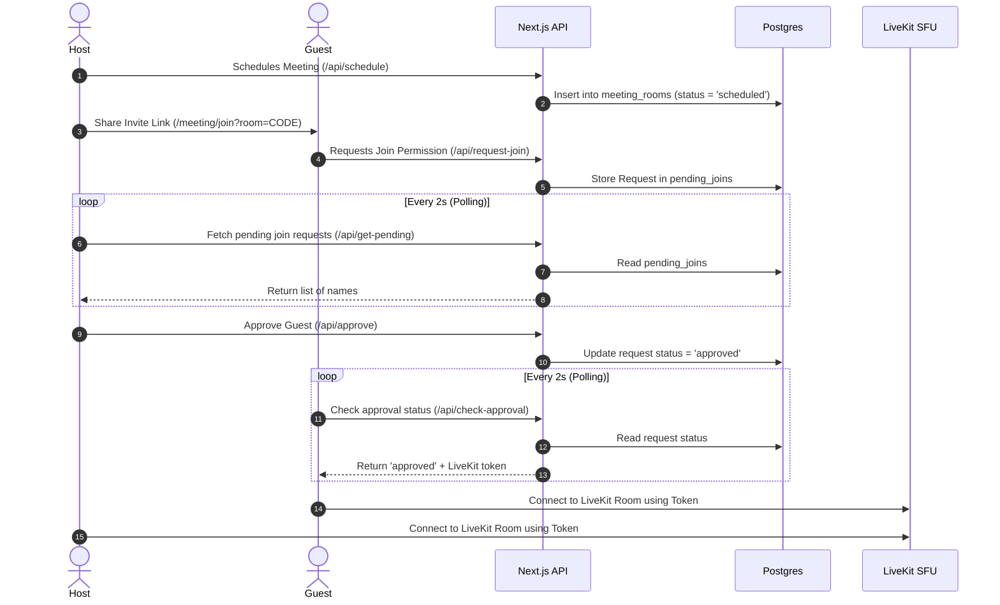
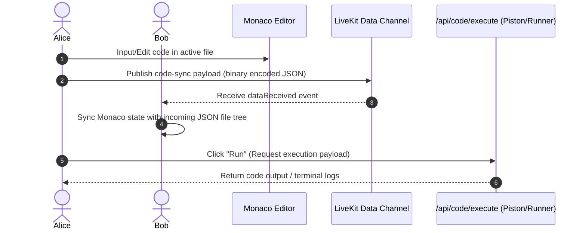
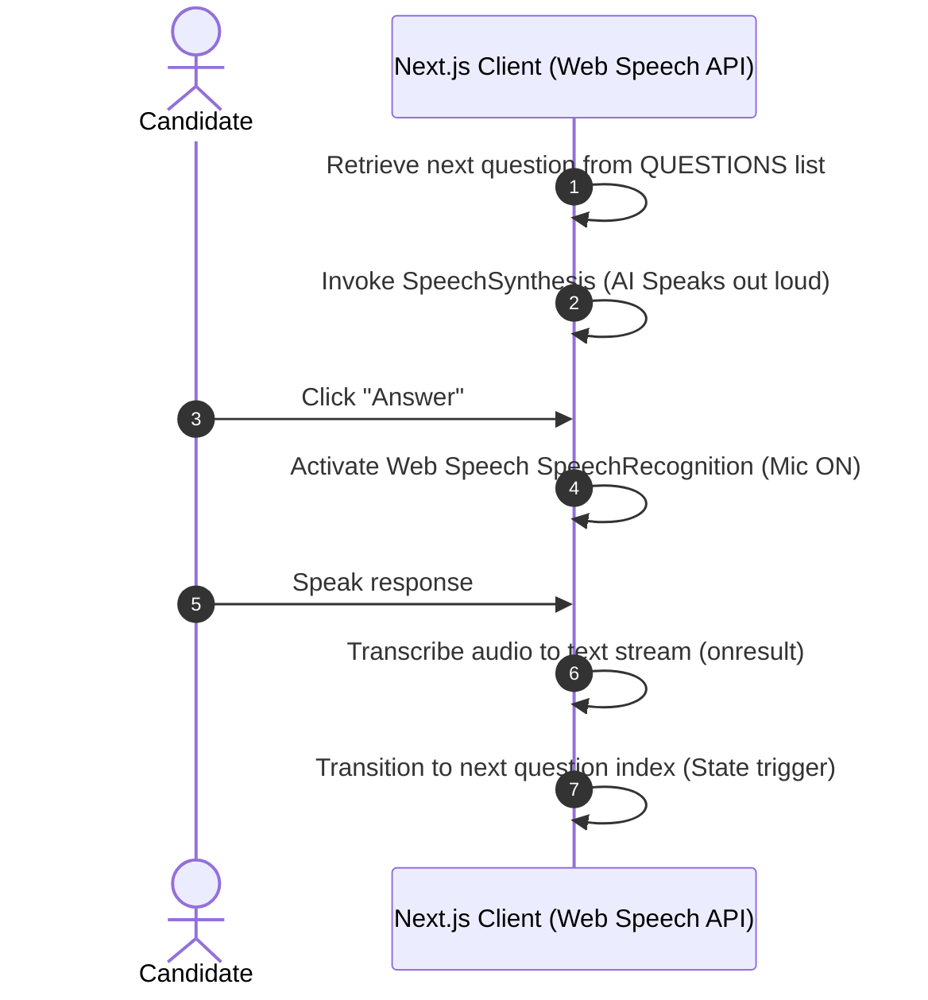
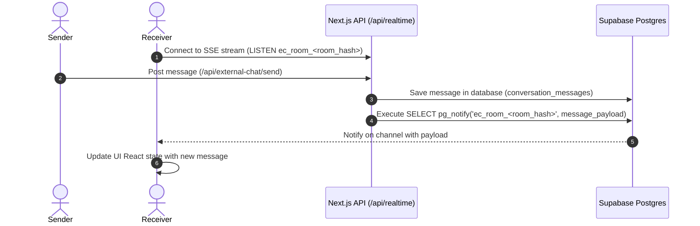

# 🧩 AIConnect: System Architecture & Workflow Document

This document provides a comprehensive overview of the **AIConnect** platform, detailing its architecture, tech stack, data design, and the runtime workflows that drive its collaboration and interview features.

---

## 🛠️ 1. Technical Stack

AIConnect is built with a modern, serverless-friendly, and highly interactive stack optimized for real-time engagement and low latency.



### 💻 Frontend (Client Side)
*   **Core Framework**: **Next.js 16 (App Router)** utilizing **React 19** and **TypeScript** for robust typing.
*   **Styling & UI**:
    *   **Tailwind CSS v4** for clean, utility-first layout styling.
    *   **Radix UI Primitives** (Accordion, Dialog, Tabs, Dropdowns, etc.) for accessible, headless interactive UI elements.
    *   **Framer Motion / Motion** for smooth, GPU-accelerated interface animations and transitions.
    *   **Lucide React** for modern, lightweight SVG icons.
*   **Interactive Components**:
    *   **Monaco Editor** (`@monaco-editor/react`) for full VSCode-like syntax highlighting, themes, and code editing features.
    *   **Sandpack React** (`@codesandbox/sandpack-react`) for containerized browser-based preview and execution of web code.
    *   **LiveKit React Components** (`@livekit/components-react`) for modular WebRTC participant video tiles, screenshare layout tracks, and room connection states.
*   **Speech Synthesis & Recognition**:
    *   **Web Speech API** (`SpeechRecognition` & `SpeechSynthesis`) for serverless voice interaction with the AI Interviewer.

### ⚙️ Backend (Server Side)
*   **Routing & APIs**: Next.js Server Components, API routes, and Route Handlers.
*   **Authentication**: **Clerk** (`@clerk/nextjs`) handling user session validation, JWT mapping, login, signup, and profile sync.
*   **Object Storage**: **AWS S3 / Compatible Storage** (`@aws-sdk/client-s3`) using **S3 Presigned URLs** for secure, direct-to-bucket uploads of user recordings, chat attachments, and generated media.
*   **Mailing Services**: **Nodemailer** and **Resend** for sending scheduled notifications and invite updates.
*   **AI Integrations**: **OpenAI SDK** (`openai`) driving interview evaluation, image generation, and chat helper functionalities.

### 🗄️ Database & Real-Time Sync
*   **Primary Database**: **PostgreSQL** hosted on **Supabase**.
*   **ORM**: **Prisma Client** with `@prisma/adapter-pg` for type-safe database queries. A custom compatibility layer maps legacy tables (`chatRoom` ➡️ `conversations`, `participant` ➡️ `conversation_members`, `chatMessage` ➡️ `conversation_messages`).
*   **Direct Access Pool**: Native `pg` Connection Pool for high-performance operations, like meeting scheduling queues.
*   **Real-time Communication**: Native **PostgreSQL LISTEN / NOTIFY** protocol (`pg_notify`) used for chat rooms and peer-to-peer signaling, eliminating the need for an external Redis layer or custom WebSocket servers.

---

## 🏗️ 2. Core System Architecture

AIConnect is structured around two main collaborative paradigms:
1.  **Peer-to-Peer Meetings & Collaboration**: Leveraging a WebRTC SFU (LiveKit) for media and data streams.
2.  **Workspace Collaboration & Chat**: Leveraging a PostgreSQL PubSub network for instant messaging and event propagation.

```
       ┌────────────────────────────────────────────────────────┐
       │                  Next.js App Router                    │
       │  (Pages: /dashboard, /meeting/[code], /external-chat)  │
       └───────────────────────────┬────────────────────────────┘
                                   │
         ┌─────────────────────────┼─────────────────────────┐
         ▼                         ▼                         ▼
 ┌───────────────┐         ┌───────────────┐         ┌───────────────┐
 │ Clerk Auth    │         │  LiveKit SFU  │         │   Postgres    │
 │ (Sessions &   │         │ (WebRTC Media │         │ LISTEN/NOTIFY │
 │ Webhooks)     │         │ & Data Sync)  │         │ (Chat PubSub) │
 └───────────────┘         └───────────────┘         └───────────────┘
```

### File & Folder Structure
```bash
├── app/                      # Next.js App Router directories
│   ├── (marketing)/          # Public landing/marketing pages
│   ├── api/                  # Serverless Route Handlers (Auth, Meetings, Code Execution, AI)
│   ├── auth/                 # Clerk-based authentication pages (Sign-in / Sign-up)
│   ├── dashboard/            # User Dashboard views (Overview, Schedule, AI, Chats)
│   │   ├── 3d-image-generator/
│   │   └── ai-interview/     # Interactive mock interview setup and live loop
│   ├── external-chat/        # Chat workspace view
│   └── meeting/              # Live Collaboration pages
│       ├── [code]/           # Live room interface (Video, Monaco Editor, Chat panels)
│       ├── create/           # Meeting scheduling UI
│       └── join/             # Lobby and code join interface
├── components/               # Reusable React components
│   ├── auth/                 # Auth-related layouts
│   ├── chat/                 # Meeting chat layouts
│   ├── dashboard/            # Sidebars and view switchers
│   ├── external-chat/        # Workspace chat threads, status feeds, call controllers
│   ├── meeting/              # LiveKit streams, Monaco Editor, Participant lists
│   └── ui/                   # Shared UI kit (buttons, inputs, tabs, dialogs)
├── lib/                      # Shared helper functions, databases, and SDK config
│   ├── prisma.ts             # Prisma client initialization & legacy model translation
│   ├── db.ts                 # pg Connection Pool for direct query triggers
│   ├── external-chat-realtime.ts # PostgreSQL LISTEN/NOTIFY wrapper
│   └── livekit-server.ts     # LiveKit token generator
└── services/                 # Business logic and external API communication layers
```

---

## 🔄 3. Key Structural Workflows

### 🔑 Workflow A: User Signup and Authentication Flow


*   **Details**: Clerk handles the sign-up and authentication lifecycle. The user's metadata is retrieved on the client via `useUser()`, and matching profiles are synced with the Postgres `users` table via API handlers.

---

### 📹 Workflow B: Scheduled Meeting & Live Lobby Workflow


*   **Lobby Security**: Guests must wait in a lobby. Next.js Route Handlers poll the database to verify when a host grants access.
*   **Media Connection**: Once approved, both host and guest receive unique JSON Web Tokens (JWT) generated via the `livekit-server-sdk` to authenticate directly with the LiveKit WebRTC SFU server.

---

### 💻 Workflow C: Collaborative VSCode-like Code Editor


*   **Editor Sync**: Changes in the Monaco editor trigger a debounced function that serializes the virtual directory file tree to a JSON payload. This payload is broadcasted instantly to all other users in the room using LiveKit's low-latency WebRTC data channels (`publishData` / `dataReceived`).
*   **Code Execution**: Code is compiled and run in a sandbox via a Next.js Serverless Route Handler, which forwards the code and execution instructions to a compiler API and returns the console stdout/stderr directly to the terminal component.

---

### 🎙️ Workflow D: AI Mock Interviewer Workflow


*   **Local Web Speech**: The AI Interviewer uses the browser's built-in `SpeechSynthesis` and `SpeechRecognition` engines. This provides responsive voice feedback and transcription without requiring heavy external cloud AI media API dependencies.

---

### 💬 Workflow E: Real-time Workspace Chat (PostgreSQL PubSub)


*   **Serverless PubSub**: Realtime synchronization utilizes PostgreSQL’s native notification system (`LISTEN/NOTIFY`).
*   **Lifecycle**: When a user registers a listener, the server keeps an open HTTP connection (Server-Sent Events) and executes `LISTEN` for that room code in Postgres. Whenever a message is sent, the server saves it in the DB and triggers a `NOTIFY`. Postgres immediately alerts all subscribed server instances, which push the events down to their corresponding client connections.

---

## 📐 4. Database Schema Design (Key Tables)

Below is an overview of the core PostgreSQL entities mapped in `schema.prisma`:

| Model Name | Table Name | Purpose | Key Relationships |
| :--- | :--- | :--- | :--- |
| `User` | `users` | Core user identity synced from Clerk. | Relations to files, workspaces, read receipts, and calls. |
| `Meeting` | `meetings` | Tracks individual meeting metadata and details. | Mapped to `Recording` and `MeetingNote`. |
| `meeting_rooms` | `meeting_rooms` | Persistent records of video rooms scheduled on the dashboard. | Has list of attendees (`MeetingRoomMember`). |
| `File` | `files` | Tracks collaborative files shared in rooms or workspaces. | Uploaded by `User`, resides in a `Conversation`. |
| `ExternalChatWorkspace`| `external_chat_workspaces`| High-level grouping of channels, direct chats, and members. | Built by `User`, houses many `Conversation` records. |
| `Conversation` | `conversations` | Repositories for group chat, private chat, or workspace channels.| Mapped to `ConversationMember`, `ConversationMessage`, `ExternalChatCallSession`. |
| `ExternalChatStatus` | `external_chat_statuses`| User stories/status updates (expire after 24h). | Has `ExternalChatStatusReaction`, `ExternalChatStatusComment`, `ExternalChatStatusView`. |
| `ExternalChatCallSession`| `external_chat_call_sessions`| Persistent logs of voice/video calls inside chat channels.| Links caller, receiver, and participant logs. |

---

## 🔒 5. Verification & Deployment Steps
1.  **Local Environment**: Copy environment templates (`cp .env.example .env`) and supply correct keys (`DATABASE_URL`, `NEXT_PUBLIC_CLERK_PUBLISHABLE_KEY`, `LIVEKIT_API_KEY`, `LIVEKIT_API_SECRET`).
2.  **Database Migration**: Run `pnpm prisma generate` to sync TS typings. Schema is applied to PostgreSQL using Prisma migrations (`prisma/migrations/*`).
3.  **Local Run**: Run `pnpm dev` to run the development server.

---

## 🚀 6. Hyper-Scale Architecture Review (500,000 – 1,000,000 Group Members)

### Critical Audit of Current Architecture & Schema
A code-level audit of the current codebase reveals specific bottlenecks that block scaling beyond ~5,000–10,000 concurrent members in a single room:

| Layer | Current Implementation | Bottleneck at 500k–1M Members |
| :--- | :--- | :--- |
| **Realtime Pub/Sub** | `lib/external-chat-realtime.ts` uses a single `pg.Client` (`LISTEN` / `NOTIFY`) with an in-memory `Map` and clears `subscribedChannels` on socket errors. | PostgreSQL `NOTIFY` has an **8,000-byte payload limit**, serializes through one Postgres connection, lacks message replay, and drops channel subscriptions on reconnect. |
| **Client Transport** | `app/api/external-chat/realtime/[roomCode]/route.ts` holds long-lived SSE connections inside Next.js Node workers, followed by `scheduleRealtimeRefresh()` HTTP re-fetches of `/messages` & `/rooms`. | Thundering herd: 1 message triggers 500k–1M simultaneous `GET /messages?limit=60` HTTP queries into Postgres. |
| **Read Receipts** | `ExternalChatReadReceipt` writes 1 row per `(messageId, userId)`. | A single active hour (100 messages across 500k readers) would attempt **50 million row inserts**, exhausting WAL & table locks. |
| **Room Member Queries** | Membership checks & room listings join/load `external_chat_room_members` without cursor limits or external cache. | Loading member lists in JSON responses or broadcasting full membership arrays breaks memory/network ceilings at 1M rows per room. |
| **Rate Limiting** | `services/rate-limit.service.ts` performs synchronous Postgres `upsert` (`increment: 1`) on `rate_limit_events`. | Row-level contention in Postgres on every message, reaction, or typing event. |
| **Storage & Schema Naming Note** | Section 4 above references `conversations`, whereas the active Prisma schema uses `external_chat_rooms`, `external_chat_room_members`, `external_chat_messages`, `external_chat_upload_sessions`, `external_chat_room_keys`, `external_chat_starred_messages`, `external_chat_call_sessions`, and `push_subscriptions`. | Storage upload paths now stream to S3 or local disk multipart chunks (`10 GB` max), whereas meeting chat (`chat-file.service.ts`) still uses `arrayBuffer()` in memory and should be migrated to streaming. |

---

### Target Blueprint for 500k–1M Member Super-Groups

```text
[Clients: Web / PWA / Mobile]
   │  ├── HTTPS REST (Next.js Stateless API Fleet)
   │  └── WSS (Dedicated Go/Rust WebSocket Gateway Cluster, 8–20 pods)
   ▼
[L4 Anycast/NLB + L7 Envoy Proxy (Path-Based HTTP vs WS Routing)]
   │
   ├──► [Redis Cluster (Pub/Sub Shards, Presence Bitmaps, Rate Limits, Room Auth Cache)]
   ├──► [Kafka / Redpanda Cluster (Partitioned by hash(roomId))]
   │         ├──► [Fan-Out Consumers] ──► Push delta frames to WS Gateways
   │         ├──► [Batch DB Writers]  ──► Partitioned Postgres (HASH room_id + RANGE created_at)
   │         └──► [Push Workers]      ──► Coalesced APNs / FCM v1 / Web Push VAPID
   └──► [PgBouncer Transaction Pooler] ──► [Primary Postgres + Read Replicas]
```

#### 1. Message Fan-Out (Hybrid Write-Once + Pull-Delta Architecture)
*   **Avoid O(N) per-user inbox writes**: Persist each group message **once** in Postgres with a monotonically increasing per-room sequence number (`roomSeqId BIGINT` assigned via atomic Redis `INCR` or sequence table) instead of creating per-recipient delivery rows.
*   **Fan-Out-on-Read for Offline/Idle Users**: Only **online subscribers currently attached to WS gateways** receive live WebSocket frames (`msg_delta` containing payload directly—eliminating the post-SSE HTTP `GET /messages` thundering herd).
*   **Offline Catch-Up**: On reconnect or room open, clients request `GET /messages?afterSeq=<lastSeqId>&limit=50`, utilizing keyset pagination (`(room_id, room_seq_id) > ($1, $2)`).
*   **Broadcast Rate Shaping**: In 1M-member channels, clamp typing indicators (disable broadcast or sample top active speakers when `memberCount > 500`) and coalesce delivery/read counts in Redis HyperLogLog/counters rather than streaming individual read receipts.

#### 2. WebSocket Gateway Scalability
*   **Decouple from Next.js**: Move real-time connections out of Next.js Route Handlers into a dedicated stateless **WebSocket Gateway tier** (e.g., Go `nhooyr/websocket` or Rust `tokio-tungstenite` / Centrifugo) compiled with epoll/kqueue tuning (`fs.file-max`, `somaxconn >= 65535`).
*   **Connection Math**: Each 4 vCPU / 8 GB gateway node comfortably holds `100,000–200,000` concurrent idle TLS WebSockets (~30–50 KB heap per conn). Supporting **1,000,000 concurrent members online** requires **10–12 active gateway nodes** across 3 AZs (plus 30% headroom = ~15 pods).
*   **Hub Routing**: Use consistent room subscriptions per gateway (`Subscribe(roomId)` once per gateway pod via Redis Sharded Pub/Sub or NATS JetStream, NOT 1 subscription per user) so a gateway hosting 40,000 members of the same group receives **only 1 upstream pub/sub frame** and loops locally in RAM to its 40k open sockets.

#### 3. Redis & Distributed Queues
*   **Redis Cluster (Sharded)**:
    *   `Sharded Pub/Sub` (`SPUBLISH`/`SSUBSCRIBE`, Redis 7+) for ephemeral gateway fan-out and presence updates across cluster slots.
    *   `Hot Message Window` (`LIST` / `ZSET` capped at last 100 messages per hot room) so 99% of joins serve initial history from Redis RAM without hitting Postgres.
    *   `Ephemeral Presence`: Redis Roaring Bitmaps or `SET`s with TTL heartbeats (`SETEX`) instead of SQL updates.
*   **Apache Kafka / Redpanda (Durable Event Backbone)**:
    *   Topic `chat.messages` partitioned by `roomId` (`>= 128 partitions`).
    *   Enables backpressure buffering during bursts (10k msgs/sec) and asynchronous multi-consumer pipelines: durable batch DB inserts, search indexing, push notifications, and translation pre-warming.

#### 4. Database Indexing & Partitioning
*   **Table Partitioning (`external_chat_messages`)**: Migrate to declarative composite partitioning: **HASH partition on `room_id` (32–64 shards)** sub-partitioned by **RANGE on `created_at` (monthly)** so hot partitions fit in Postgres `shared_buffers`.
*   **Keyset Pagination Only**: Replace cursor `OFFSET` / timestamp ties with strict `(room_id, seq_id DESC)` composite B-Tree index (`WHERE room_id = $1 AND seq_id < $2 ORDER BY seq_id DESC LIMIT 50`).
*   **Replace Row-Per-Read Receipts**: Store only a single **high-water mark** per user on `external_chat_room_members.last_read_seq_id BIGINT` (flushed asynchronously every 5–10s in batch). Expose exact viewer lists only when `memberCount <= 250`; switch to Redis `PFADD` (HyperLogLog) approximate seen counts (`~50k seen`) for super-groups.
*   **Read Replicas + PgBouncer**: Route all `GET /rooms` and message history reads through PgBouncer in `transaction` pooling mode to dedicated read replicas.

#### 5. Group Membership & Key Management Storage
*   **Tiered Storage & Bloom Filters**: Partition `external_chat_room_members` by `HASH (room_id)` with covering index `(room_id, left_at, removed_at, user_id) INCLUDE (role, muted)`.
*   **Fast Gateway Authorization**: Gateways must NOT query Postgres on every frame. Cache room membership ACLs in Redis (`SISMEMBER room:{id}:members {userId}` or Cuckoo/Bloom filter for negative fast-fail) + short-TTL (60s) JWT room capability tokens signed by Next.js API.
*   **E2EE Scaling Limit & Migration Path**: Pairwise/per-member wrapped keys (`ExternalChatRoomKey`) scale as `O(N)` per key rotation and should be enforced only for `type = direct` and groups `<= 500` members. For E2EE in larger groups (>500), transition to **MLS (Message Layer Security, RFC 9420)** `O(log N)` TreeKEM ratchet trees or server-fanned channel broadcast mode.

#### 6. Notification Delivery
*   **Asynchronous Worker Pool**: A Kafka consumer reads `chat.messages`, queries only `push_subscriptions` matching **active, unmuted, offline** recipients in deterministic 5,000-user keyset batches (ignoring muted rooms/users).
*   **Coalescing & Suppression**: Maintain a Redis debounce key (`notif:{userId}:{roomId}`) so rapid bursts in a 500k-member group collapse into *"Room X: 42 new messages"* rather than firing 42 push alerts.
*   **Priority Queues**: Separate high-priority topic/queue for `1:1 incoming calls` (`TTL = 45s`, APNs `apns-priority: 10`, FCM `priority: high`) from standard message digest batches.

#### 7. Rate Limiting
*   **Move Out of Postgres**: Replace `rateLimitEvent.upsert()` in `services/rate-limit.service.ts` with atomic **Redis Lua token-bucket / sliding-window counters** (sub-millisecond latency).
*   **Multi-Tier Quotas**:
    *   Edge IP / User bucket (`req/sec`) at Envoy/CDN.
    *   Room-level Slow Mode (`cooldownSec` per user per room: e.g. max 1 message / 10s enforced via `SET room:{id}:cooldown:{userId} 1 EX 10 NX`).
    *   Global room ingress cap (drop/defer low-priority typing & presence frames first under spike load).

#### 8. Infrastructure Costs (Monthly Estimate for ~1M Peak Concurrent / 500k–1M Super-Group)
Assumes multi-AZ AWS `us-east-1` / GCP baseline with reserved capacity (~30–40% savings over pure on-demand):

| Component | Sizing | Est. Monthly Cost (USD) |
| :--- | :--- | :--- |
| **WebSocket Gateway Tier** | 15 × `c7g.xlarge` (4 vCPU, 8 GB, ARM64) | ~$1,400 |
| **Next.js API & SSR Fleet** | 8 × `c7g.large` behind ALB | ~$450 |
| **Redis Cluster (3 shards + replicas)** | 6 × `r7g.xlarge` (26 GB RAM each) | ~$1,850 |
| **Kafka / Redpanda (3 brokers + EBS)** | 3 × `i3en.xlarge` or Confluent/MSK | ~$1,200 |
| **PostgreSQL (Primary + 2 Read Replicas)** | 3 × `db.r6g.2xlarge` (8 vCPU, 64 GB) + 2 TB GP3 | ~$3,400 |
| **Worker Fleet (Notifs, Transcode, Media)** | 6 × `c7g.large` spot/on-demand | ~$280 |
| **S3 + CloudFront CDN (Media/10GB Files)** | 10 TB storage + 50 TB egress (CloudFront) | ~$2,500–$4,200 |
| **LiveKit Cloud / Self-Hosted SFU** | Voice/Video 1:1 & 100-cap conferences | ~$800–$2,000 |
| **Observability & Load Balancing** | ALB/NLB LCU + Prometheus/Grafana/OpenTelemetry | ~$550 |
| **Estimated Total** | | **~$12,400 – $15,300 / month** |

#### 9. Load Balancing
*   **Two-Tier Balancing**:
    *   Use AWS NLB / GCP Network LB at L4 with TLS termination at **Envoy L7** proxies.
    *   Route `/ws/*` to WebSocket Gateway target groups (least-connections routing, `300s+` idle timeout, WebSocket ping/pong every `25s`).
    *   Route `/api/*` to Next.js API containers (short timeouts `30s`, except chunked `PUT /api/external-chat/uploads/.../parts/*` which can stream directly via S3 Presigned Multipart URLs to offload proxy bandwidth).
*   **Media / 10 GB Uploads Bypass**: In production, direct browser-to-S3/R2 **Presigned Multipart URLs** eliminate multi-gigabyte proxy buffering through Next.js/Envoy while keeping chunk checksums and session tracking in Postgres.

#### 10. Failure Recovery & High Availability
*   **Gateway Crash / Deploy Drain**: Gateways send `GOAWAY` / close frame `1001` cleanly. Clients reconnect with **exponential backoff + full jitter** (`min(30s, 1s * 2^attempt) * random(0.5..1.0)`) so a 500k-user pod restart spreads reconnections over 30–60s instead of a thundering herd.
*   **Gapless Replay**: Client tracks `lastSeqId` per room and automatically calls `/messages?afterSeq=<lastSeqId>` after WS reconnect to reconcile any missed frames during outage windows.
*   **Idempotent Delivery**: Client sends `clientMutationId` (UUID) with every message; API + Kafka consumer deduplicate retries seamlessly.
*   **Circuit Breakers & Graceful Degradation**:
    *   If Kafka lags or Redis saturates, disable typing indicators, presence updates, and translation enrichment automatically while preserving core message delivery.
    *   Automated Postgres PITR + Multi-AZ synchronous standby failover (Patroni / RDS Multi-AZ) and Kafka Dead-Letter Queues (DLQ) for failed push deliveries.
